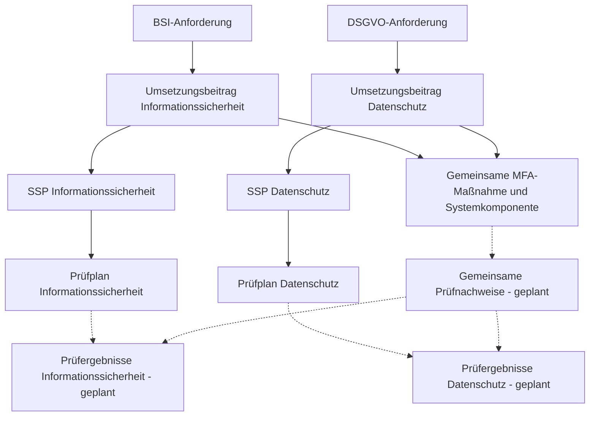

# Collaborative OSCAL

**Gemeinsame Compliance-Daten. Unabhängige fachliche Bewertungen.**

Read this README in [English](README.md).

Collaborative OSCAL ist ein selbst hostbarer Proof of Concept für die Zusammenarbeit in der Informationssicherheit, im Datenschutz und im Compliance-Management auf Grundlage des offenen, vom NIST entwickelten Standards [OSCAL (Open Security Controls Assessment Language)](https://pages.nist.gov/OSCAL/).

Das Projekt untersucht, wie Organisationen Sicherheitsmaßnahmen, Systeminformationen und künftig geeignete Prüfnachweise über unterschiedliche regulatorische Rahmenwerke hinweg wiederverwenden können, ohne deren Anforderungen gleichzusetzen oder Compliance-Bewertungen automatisch zu übertragen.

> **Projektstatus:** Experimenteller Proof of Concept in aktiver Entwicklung. Nicht für den Produktivbetrieb oder die Verarbeitung vertraulicher Daten vorgesehen.

## Schnellstart

Voraussetzung ist eine funktionsfähige Docker-Installation mit Docker Compose. Im Repository-Verzeichnis:

```bash
docker compose up
```

Die Anwendung ist unter [http://localhost:3000](http://localhost:3000) erreichbar.

Die lokale Demo startet ohne externen Identity Provider. Sie ist ausschließlich für lokale Entwicklung und Vorführungen vorgesehen. Alle Personen mit Zugriff auf die Demo-Oberfläche verwenden dieselbe Demo-Identität. Die Demo darf weder öffentlich bereitgestellt noch mit produktiven oder vertraulichen Daten betrieben werden.

Die Oberfläche ist auf Englisch und Deutsch verfügbar. Die Sprachauswahl beeinflusst ausschließlich die Oberfläche, nicht importierte OSCAL-Inhalte oder selbst verfasste Beschreibungen.

Hinweise zu Setup, Tests und technischen Details stehen im [Entwicklerleitfaden](docs/development.md).

## Motivation

Informationssicherheit und Datenschutz betrachten häufig dieselben Systeme und technischen und organisatorischen Maßnahmen (TOM), arbeiten jedoch mit unterschiedlichen regulatorischen Anforderungen, Dokumentationen und Prüfprozessen. Dadurch können Doppelarbeit und getrennte Informationsbestände entstehen.

Collaborative OSCAL unterscheidet drei Ebenen:

- **Anforderungen:** Jeder normative oder organisationsspezifische Katalog behält seine eigene Identität, seinen Inhalt und seine Revisionshistorie.
- **Umsetzung:** Wiederverwendbare Maßnahmen und konkrete Systemkomponenten können Anforderungen verschiedener Kataloge adressieren.
- **Prüfung:** Prüfumfang, Prüfziele und fachliche Bewertungen bleiben kontextspezifisch. Die gemeinsame Nutzung geeigneter Nachweise ist eine geplante Erweiterung und keine Übertragung von Prüfergebnissen.

OSCAL stellt dafür eine maschinenlesbare Datengrundlage bereit. Mögliche Quellen sind BSI IT-Grundschutz++, DSGVO, ISO/IEC 27001 und 27002, NIST SP 800-53 sowie interne Richtlinien. Voraussetzung sind geeignete OSCAL-Kataloge und die entsprechenden Nutzungsrechte. Dies sind angestrebte Anwendungsfälle, keine Aussage darüber, dass alle Kataloge bereits mitgeliefert oder vollständig unterstützt werden.

### Beispiel: Multifaktor-Authentifizierung

Ein Informationssicherheitsbeauftragter (ISB) bewertet eine Anforderung zum Schutz privilegierter Zugänge. Ein Datenschutzbeauftragter (DSB) betrachtet die Sicherheit der Verarbeitung personenbezogener Daten nach Art. 32 DSGVO.

Beide können dieselbe Maßnahme zur Multifaktor-Authentifizierung (MFA) und denselben Identity Provider referenzieren. Die jeweiligen Beiträge zur Erfüllung ihrer Anforderungen werden separat dokumentiert. In der geplanten Assessment-Schicht könnten beide einen geeigneten Konfigurationsexport oder ein Testprotokoll ausdrücklich wiederverwenden und dennoch unabhängige Feststellungen treffen.



Durchgezogene Linien veranschaulichen bereits unterstützte Konzepte; gestrichelte Linien stehen für geplante Funktionalität. MFA kann einen Beitrag zu Art. 32 DSGVO leisten, begründet aber allein keine Konformität mit diesem Artikel.

## Aktueller Funktionsumfang

| Bereich | Funktion | Status |
| --- | --- | --- |
| Anforderungskataloge | Import, hierarchische Darstellung, unveränderliche Quellrevisionen | Implementiert |
| Anforderungsprofile | Explizite Auswahl aus verschiedenen Katalogrevisionen | Implementiert; Auflösung zurückgestellt |
| Anforderungszuordnungen | Explizite katalogübergreifende Beziehungen; keine automatische Compliance-Ableitung | Implementiert |
| Komponentendefinitionen | Wiederverwendbare Maßnahmen und Kontrollen | Implementiert |
| Umsetzungsregister | Anforderungsspezifische Umsetzungsbeiträge und Verantwortlichkeiten | Implementiert |
| Systeme | Gemeinsame konkrete Systemkomponenten | Implementiert |
| Systemsicherheitspläne (SSP) | Katalogbasierte SSP, Validierung und unveränderliche Dokumentversionen | Implementiert |
| Prüfpläne (AP) | Prüfumfang, Prüfziele, Aktivitäten, Aufgaben, Rollen, historische SSP-Referenzen, Validierung und Versionierung | Implementiert; abschließender manueller UI-Test offen |
| Prüfergebnisse (AR) | Beobachtungen, Nachweise und Feststellungen | Geplant |
| Gemeinsame Prüfnachweise | Explizite Wiederverwendung in unabhängigen Prüfungen | Geplant |
| POA&M | Planung und Nachverfolgung von Verbesserungsmaßnahmen | Geplant |

Darüber hinaus unterstützt die Anwendung OpenID-Connect-Authentifizierung (OIDC), mandantenbezogene Autorisierung, deutsche und englische Oberflächen sowie OSCAL-JSON-Import und/oder -Export entsprechend dem jeweiligen Dokumentmodell.

## Architektur und Datenintegrität

Die technische Grundlage bilden Next.js und TypeScript, FastAPI und Python, PostgreSQL, [Compliance Trestle](https://github.com/oscal-compass/compliance-trestle), OpenID Connect und Docker Compose.

Zentrale Architekturentscheidungen:

- Importierte Katalogrevisionen und veröffentlichte SSP-/Prüfplanversionen sind unveränderlich. Historische Referenzen bleiben an den ursprünglichen Dokumentstand gebunden.
- Wiederverwendbare Maßnahmen, konkrete Systemkomponenten und anforderungsspezifische Umsetzungsbeiträge werden getrennt verwaltet.
- Eine dokumentierte Umsetzung ist kein Nachweis ihrer Wirksamkeit. Anforderungszuordnungen übertragen weder Compliance-Status noch Prüfergebnisse automatisch.
- Die OSCAL-Verarbeitung folgt einem Trestle-first-Ansatz, ergänzt durch versionsspezifische offizielle NIST-JSON-Schemas sowie anwendungsspezifische Referenz- und Integritätsprüfungen.
- Neue Dokumente verwenden OSCAL 1.2.1, soweit dies der festgelegten Authoring-Strategie entspricht. Importierte und historische Dokumente behalten ihre deklarierte Version und werden nicht stillschweigend konvertiert.
- Das PostgreSQL-basierte Datenmodell verbindet Dokumentinhalte mit relationalen Identitäten, Mandantengrenzen und expliziten Referenzen.

Architekturentscheidungen und Abwägungen werden in Architecture Decision Records (ADRs) im Repository dokumentiert.

### Bekannte Einschränkungen

Die vollständige Profilauflösung (Profile Resolution) wurde nach Kompatibilitätstests bewusst zurückgestellt. Profile können erstellt werden; die Anwendung erhebt jedoch nicht den Anspruch, daraus einen korrekt aufgelösten Katalog zu erzeugen. SSP referenzieren derzeit direkt eine Katalogrevision.

Prüfergebnisse, gemeinsame Prüfnachweise, POA&M und PDF-Berichte sind noch nicht verfügbar. Technisch valide OSCAL-Dokumente belegen weder regulatorische Konformität noch garantieren sie die Interoperabilität mit jedem externen OSCAL-Werkzeug.

## Agentische Softwareentwicklung und AI Governance

Collaborative OSCAL ist zugleich ein Experiment zur menschlich kontrollierten, LLM-gestützten Softwareentwicklung. Ein erheblicher Teil des Codes wurde mit KI-Unterstützung erstellt, vorwiegend mit GitHub Copilot. ChatGPT unterstützt Konzeption, Aufgabenstellung und kritische Reviews.

Zum Entwicklungsprozess gehören menschliche Entscheidungen und explizite Freigaben, Architektur-Reviews mit der Vorgabe, vor größeren Änderungen ausschließlich lesend zu arbeiten, ADRs, gezielte Regressionstests, automatisierte Integrationstests und manuelle Anwendungstests. KI-generierte Erklärungen werden bis zum Vorliegen überprüfbarer Evidenz als Hypothesen behandelt.

Ein konkretes Beispiel: Ein Validierungsfehler bei Prüfplänen wurde zunächst auf fehlerhafte lokale Prüfziele zurückgeführt, obwohl der betroffene Prüfplan keine solchen Ziele enthielt. Die Implementierung wurde erst freigegeben, nachdem eine isolierte Reproduktion ein leeres `metadata.version` als tatsächliche Ursache identifiziert hatte. Ein separater Fehler bei der Zuordnung lokaler Prüfziele wurde anschließend unabhängig nachgewiesen und korrigiert.

Der Prozess verdeutlicht, warum plausibel klingende KI-Ausgaben weder reproduzierbare Evidenz noch menschliche Verantwortung ersetzen. Er ist ein Entwicklungsansatz, keine Zertifizierung der KI-Sicherheit oder Softwarequalität.

## Qualitätssicherung

Der am **16. November 2026** nach den Korrekturen der Prüfplanvalidierung berichtete Integrationsstand:

| Prüfung | Ergebnis |
| --- | --- |
| Backend-Testsuite mit PostgreSQL | 276 Tests bestanden |
| Frontend-Testsuite | 152 Tests bestanden |
| Frontend-Lint und TypeScript-Typprüfung | Bestanden |

Gezielte Regressionstests für Prüfpläne umfassen unter anderem einen minimalen Prüfumfang, historische SSP-Referenzen mit OSCAL 1.2.3, die Erstellung einer Prüfplanversion mit OSCAL 1.2.1, wiederholte Validierung sowie die Integrität von Prüfzielreferenzen. Der abschließende manuelle Browser-Workflow bleibt eine separate Abnahmeprüfung. Diese Ergebnisse sind ein datierter Entwicklungsstand, kein Sicherheitsaudit.

## Roadmap

- [ ] Manuelle Abnahme der Prüfpläne abschließen.
- [ ] Prüfergebnisse und unabhängige Feststellungen implementieren.
- [ ] Explizite Wiederverwendung geeigneter Prüfnachweise ermöglichen.
- [ ] POA&M und Nachverfolgung von Verbesserungsmaßnahmen implementieren.
- [ ] Eigene Anforderungskataloge strukturiert bearbeiten und unveränderliche Revisionen veröffentlichen.
- [ ] Menschenlesbare PDF-Berichte bereitstellen.
- [ ] Praxisnahe Demo-Szenarien für BSI IT-Grundschutz++ und DSGVO bereitstellen.
- [ ] Interoperabilität und Profilauflösung weiter untersuchen.

## Mitwirkung und Projektstatus

Fachlicher Austausch und Beiträge aus Informationssicherheit, Datenschutz, GRC, OSCAL, Softwareentwicklung und AI Governance sind willkommen.

Die Anwendung ist ein experimenteller Proof of Concept und kein produktionsreifes GRC-Werkzeug. Für einen produktiven Einsatz sind insbesondere unabhängige Code- und Sicherheitsreviews, Härtung, weiterführende Interoperabilitätstests und geeignete Betriebskonzepte erforderlich. Die Anwendung ersetzt keine qualifizierte rechtliche, regulatorische oder sicherheitsfachliche Bewertung.

## Weiterführende Informationen

- [Entwicklerleitfaden](docs/development.md)
- [NIST OSCAL](https://pages.nist.gov/OSCAL/)
- [OSCAL Compass – Compliance Trestle](https://github.com/oscal-compass/compliance-trestle)
- [BSI – Stand-der-Technik-Bibliothek](https://github.com/BSI-Bund/Stand-der-Technik-Bibliothek)
