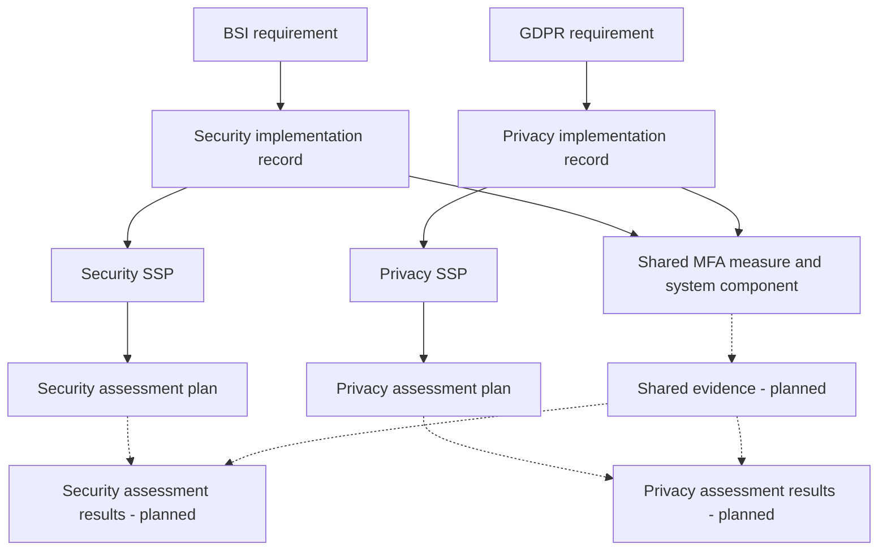

# Collaborative OSCAL

**Shared compliance data. Independent assessments.**

[Deutsch](README.de.md)

Collaborative OSCAL is a self-hosted proof of concept for collaboration across information security, data protection and compliance management, built on the open [OSCAL (Open Security Controls Assessment Language)](https://pages.nist.gov/OSCAL/) standard developed by NIST.

The project explores how organizations can reuse security measures, system information and, in the future, suitable assessment evidence across different regulatory frameworks without merging their requirements or transferring compliance judgments automatically.

> **Project status:** Experimental proof of concept under active development. Not intended for production use or processing confidential data.

## Quick start

With Docker and Docker Compose installed, run the following from the repository root:

```bash
docker compose up
```

Open [http://localhost:3000](http://localhost:3000).

The local demo starts without an external identity provider. It is intended for local development and demonstrations only. Anyone with access to the demo interface acts as the same demo user. Do not expose it publicly or use production or confidential data.

The interface is available in English and German. Language selection affects the interface only, not imported OSCAL content or user-authored descriptions.

See the [development guide](docs/development.md) for setup, testing and technical details.

## Why Collaborative OSCAL?

Information security and data protection teams often work with the same systems and technical and organizational measures (TOMs), but use different regulatory requirements, documentation and assessment processes. This can lead to duplicated work and disconnected information.

Collaborative OSCAL separates three concerns:

- **Requirements:** Each regulatory or organizational catalog retains its own identity, content and revision history.
- **Implementation:** Reusable measures and concrete system components can contribute to requirements from different catalogs.
- **Assessment:** Assessment scope, objectives and judgments remain specific to their context. Sharing suitable evidence is a planned extension, not a transfer of assessment results.

OSCAL provides a machine-readable foundation for this approach. Potential sources include BSI IT-Grundschutz++, GDPR, ISO/IEC 27001 and 27002, NIST SP 800-53 and internal policies, provided that an appropriate OSCAL catalog is available and the relevant content rights permit its use. These are target use cases, not a claim that every catalog is bundled or fully supported out of the box.

### Example: multi-factor authentication

An information security officer assesses a requirement concerning privileged access. A data protection officer assesses the security of personal data processing under Article 32 GDPR.

Both can refer to the same multi-factor authentication (MFA) measure and the same identity provider. Each documents the contribution to their own requirements. In the planned assessment layer, they could explicitly reuse a suitable configuration export or test record while reaching independent findings.



Solid lines illustrate currently supported concepts; dashed lines represent planned functionality. MFA can contribute to Article 32 GDPR but does not by itself establish compliance with that article.

## Current capabilities

| Area | Capabilities | Status |
| --- | --- | --- |
| Catalogs | Import, hierarchical browsing, immutable source revisions | Implemented |
| Profiles | Explicit requirement selection across catalog revisions | Implemented; resolution deferred |
| Control mappings | Explicit cross-catalog relationships; no automatic compliance inference | Implemented |
| Component definitions | Reusable measures and controls | Implemented |
| Implementation register | Requirement-specific implementation contributions and responsibilities | Implemented |
| Systems | Shared concrete system components | Implemented |
| System Security Plans (SSPs) | Catalog-based SSPs, validation and immutable document versions | Implemented |
| Assessment plans (APs) | Scope, objectives, activities, tasks, roles, historical SSP references, validation and versioning | Implemented; final manual UI verification pending |
| Assessment results (ARs) | Observations, evidence and findings | Planned |
| Shared assessment evidence | Explicit reuse across independent assessments | Planned |
| Plan of Action and Milestones (POA&M) | Remediation planning and tracking | Planned |

Additional capabilities include OpenID Connect (OIDC) authentication, tenant-scoped authorization, English and German UI, and OSCAL JSON import and/or export as supported by each document model.

## Architecture and data integrity

The application uses Next.js and TypeScript, FastAPI and Python, PostgreSQL, [Compliance Trestle](https://github.com/oscal-compass/compliance-trestle), OpenID Connect and Docker Compose.

Core design decisions:

- Imported catalog revisions and published SSP/AP document versions are immutable. Historical references remain pinned to the original document state.
- Reusable measures are separate from concrete system components and requirement-specific implementation contributions.
- A documented implementation is not proof of its effectiveness. Control mappings do not imply equivalent compliance status or assessment outcomes.
- OSCAL document processing follows a Trestle-first approach, supplemented by version-specific official NIST JSON Schemas and application-level reference and integrity checks.
- New documents use OSCAL 1.2.1 where supported by the approved authoring policy. Imported and historical documents retain their declared versions; they are not silently converted.
- A PostgreSQL-backed data model combines document content with relational identities, tenant boundaries and explicit references.

Architecture decisions and trade-offs are documented in the repository's Architecture Decision Records (ADRs).

### Known limitations

Full profile resolution is intentionally deferred following compatibility testing. Profiles can be authored, but the application does not claim to produce a correctly resolved catalog from them. SSPs currently use a directly referenced catalog revision.

Assessment results, shared assessment evidence, POA&M and PDF reporting are not yet available. Technically valid OSCAL documents do not establish regulatory compliance or guarantee interoperability with every external OSCAL tool.

## Agentic software engineering and AI governance

Collaborative OSCAL is also an experiment in human-governed, LLM-assisted software engineering. A substantial part of the code has been produced with AI assistance, primarily through GitHub Copilot, with ChatGPT supporting design, task specification and critical review.

The development process includes human decisions and approval gates, architecture reviews instructed to remain read-only before major changes, ADRs, focused regression tests, automated integration tests and manual application testing. AI-generated explanations are treated as hypotheses until supported by evidence.

For example, an assessment-plan validation failure was initially attributed to malformed local objectives, although the failing plan contained none. The implementation was not approved until an isolated reproduction identified an empty `metadata.version` as the actual cause. A separate objective-mapping defect was then verified and corrected independently.

This process illustrates why plausible AI output is not a substitute for reproducible evidence or human accountability. It is an engineering approach, not a certification of AI safety or software quality.

## Verification

The reported integration baseline on **16 November 2026**, following the assessment-plan validation fixes, is:

| Check | Result |
| --- | --- |
| Backend suite with PostgreSQL | 276 tests passed |
| Frontend suite | 152 tests passed |
| Frontend lint and TypeScript type checking | Passed |

The focused assessment-plan regression coverage includes minimal scope, historical OSCAL 1.2.3 SSP references, OSCAL 1.2.1 AP version creation, repeated validation and objective reference integrity. The final manual browser workflow remains a separate acceptance check. These results are a dated development snapshot, not a security audit.

## Roadmap

- [ ] Complete manual acceptance testing of assessment plans.
- [ ] Implement assessment results and independent findings.
- [ ] Enable explicit reuse of suitable assessment evidence.
- [ ] Implement POA&M and remediation tracking.
- [ ] Add structured authoring of custom catalogs with immutable published revisions.
- [ ] Add human-readable PDF reporting.
- [ ] Provide realistic BSI IT-Grundschutz++ and GDPR demonstration scenarios.
- [ ] Further evaluate interoperability and profile resolution.

## Contributing and project status

Feedback and contributions from information security, privacy, GRC, OSCAL, software engineering and AI governance practitioners are welcome.

This is an experimental proof of concept, not a production-ready GRC platform. Independent code and security reviews, hardening, broader interoperability testing and operational concepts are still required before production use. The software does not replace qualified legal, regulatory or security judgment.

## Further information

- [Development guide](docs/development.md)
- [NIST OSCAL](https://pages.nist.gov/OSCAL/)
- [OSCAL Compass – Compliance Trestle](https://github.com/oscal-compass/compliance-trestle)
- [BSI – Stand-der-Technik-Bibliothek](https://github.com/BSI-Bund/Stand-der-Technik-Bibliothek)
