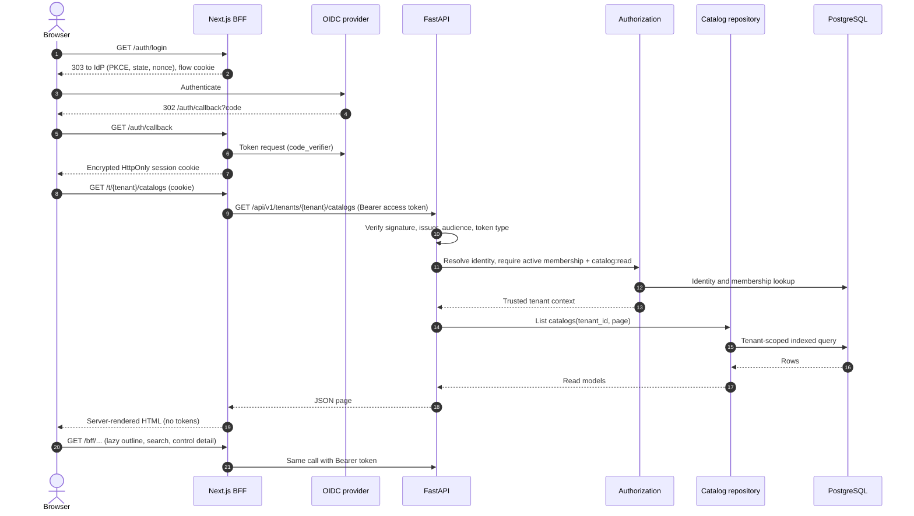

# Catalog Explorer

The Catalog Explorer is a read-only workspace for browsing tenant catalogs,
revisions, control hierarchies and control details. See
[ADR 0007](../adr/0007-browser-bff-and-catalog-explorer.md) for decisions.

## Request flow



## Components

- `apps/web/src/lib`: configuration, encrypted session, OIDC (openid-client),
  typed backend client. `src/proxy.ts` refreshes or clears sessions.
- `apps/web/src/app/auth/*`: login, callback, logout. `app/bff/[...path]`: GET-only
  allowlisted proxy for client-side lazy loading.
- `apps/web/src/app/t/[tenantId]/…`: server components. The layout re-checks
  tenant membership through `GET /api/v1/tenants`; the URL is never trusted.
- `ControlBrowser` (client component) is an ARIA tree with lazy outline loading,
  search and control detail. `ControlDetailView` renders text only.
- API: `catalog_routes.py`, `catalog_schemas.py`, `catalog_browsing.py`,
  `catalog_queries.py`; OSCAL extraction in `packages/oscal` (`control_view.py`).

## API

All paths are prefixed with `/api/v1` and require a bearer access token.

| Endpoint | Notes |
| --- | --- |
| `GET /tenants` | Tenants with active membership only |
| `GET /tenants/{t}/catalogs?q&limit&offset` | Paginated, ordered by name then ID |
| `GET …/catalogs/{c}` | Metadata, latest revision, revision count |
| `GET …/catalogs/{c}/revisions?lifecycle_status` | Newest first |
| `GET …/revisions/{r}` | Revision metadata, counts, source document info |
| `GET …/revisions/{r}/outline?parent_kind&parent_id` | One hierarchy level (groups and controls) in display order |
| `GET …/revisions/{r}/controls?q&limit&offset` | Flat search by ID or title |
| `GET …/revisions/{r}/controls/{oscal_control_id}` | Full control detail |

Errors use `{"detail": …}`: 401 (no/invalid token), 403 (no membership or
permission, identical for unknown tenants), 404 (missing within the tenant),
422 (validation). OpenAPI is served at `/docs`.

Performance assumptions: indexes on tenant/catalog/revision scoping and
`(revision, parent, display_order)`; page size ≤ 200; no N+1 queries (covered by a
query-count test); `ILIKE` search suits thousands of controls per revision.

## Control references (Profile Composer readiness)

Every control detail carries `reference = {catalog_id, revision_id,
oscal_control_id}` plus the OSCAL document UUID and source OSCAL version. A future
profile will persist exactly this triple (and tenant), so a selection always
identifies one control in one immutable revision; resolution can then read the
revision's JSONB. The UI reserves an "Add to Profile" slot that is non-interactive.

## Local setup

1. `docker compose -f infrastructure/docker/compose.yaml up -d db`; migrate with
   `uv run alembic -c ../../alembic.ini upgrade head` (from `apps/api`).
2. Create a tenant and import samples (no public import endpoint exists):

   ```bash
   cd apps/api
   uv run python -m app.cli create-tenant --name "Acme Corp" --slug acme
   uv run python -m app.cli import-catalog --tenant-id <TENANT_ID> \
     --file ../../examples/catalogs/sample-security-practices.json \
     --source-organization "Collaborative OSCAL samples" --license-identifier CC0-1.0
   ```

   Use `--catalog-id <ID>` to add a further revision of an existing catalog. Any
   OSCAL 1.2.1 JSON/YAML file can be imported the same way; do not commit content
   you may not redistribute (for example ISO/IEC text).
3. Start Keycloak (`--profile identity`, with `KEYCLOAK_ADMIN_USERNAME/PASSWORD`
   exported), then create a user without committing credentials:

   ```bash
   KEYCLOAK_ADMIN_USERNAME=… KEYCLOAK_ADMIN_PASSWORD=… \
   DEV_USER_NAME=alice DEV_USER_PASSWORD=… infrastructure/keycloak/create-dev-user.sh
   ```

   The script prints the user's `sub`. Keycloak's dev container uses an
   in-container database, so recreating it requires recreating the user and
   re-running bootstrap with the new `sub`.
4. Grant membership: `uv run python -m app.cli bootstrap-admin --issuer
   $OIDC_ISSUER_URL --subject <sub> --tenant-id <TENANT_ID>`.
5. Set the web variables from `.env.example` (`SESSION_SECRET` via
   `openssl rand -base64 48`), run the API (`uvicorn app.main:app`) and web
   (`npm --workspace apps/web run dev`), then open http://localhost:3000.

The dev realm defines client `collaborative-oscal-web` (public, PKCE S256,
redirect `http://localhost:3000/auth/callback`, post-logout
`http://localhost:3000/signed-out`) and the audience scope/resource client
`collaborative-oscal-api`. Access tokens carry `typ: Bearer`, matching the API's
`OIDC_ACCESS_TOKEN_TYPE_VALUE=Bearer` discriminator (set it when using Keycloak).

## Verification status

- Automated: backend API/authorization/security tests against PostgreSQL;
  frontend unit, component, page and route tests (Vitest).
- Live Keycloak 26.8.2 run (manual, scripted over HTTP): login via PKCE,
  session cookie HttpOnly/SameSite, access token with `aud`, `sub`, `typ=Bearer`,
  `/api/v1/me` success, catalog listing, other-tenant rejection (403 in API, BFF
  and page), cross-origin logout rejected, logout ends the Keycloak session and
  subsequent `/bff` calls return 401. This run is not in CI.
- Not covered: a real-browser (Playwright) test, token-refresh against a live
  provider, and multi-instance session behaviour.
