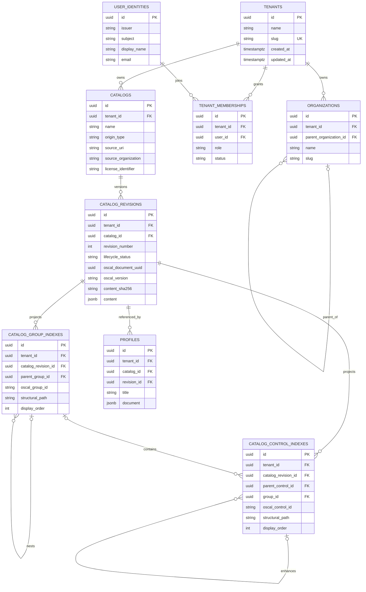

# Initial GRC domain and persistence model

The API has domain models under `apps/api/app/domain`, application services under
`apps/api/app/application`, PostgreSQL records and tenant-scoped repositories under
`apps/api/app/persistence`, and OSCAL document helpers under `packages/oscal`. These
are logical modules in the existing modular monolith, not deployable services.
Tenant-scoped Catalog and basic Profile endpoints are exposed; broader GRC workflows
are not implemented.

## Entities and ownership

- A **Tenant** is the isolation and ownership boundary. Its slug is globally unique.
- A **UserIdentity** represents one external OIDC identity and is uniquely keyed by
  `(issuer, subject)`. Email is optional profile data, not an identity key.
- A **TenantMembership** relates one identity to one tenant with a tenant-specific
  role and active/inactive status. Login does not create memberships.
- A **Tenant** can own multiple **Organizations** and **Catalogs**.
- An **Organization** belongs to exactly one tenant and may have one parent in that
  same tenant. Slugs are unique within a tenant. The create operation rejects
  cross-tenant parents; the domain hierarchy invariant also rejects a cyclic parent
  chain if hierarchy mutation is introduced later.
- A **Catalog** is the tenant-owned logical identity of a catalog. Imported source
  URI, source organization, and license are provenance fields; they do not transfer
  ownership or make a catalog globally shared. `origin_type` distinguishes imported
  and custom catalogs.
- A **CatalogRevision** belongs to one catalog and tenant. Its database UUID and
  sequential per-catalog revision number are separate from the preserved OSCAL
  document UUID. Each revision stores its full OSCAL document as JSONB, version
  metadata, source version, deterministic SHA-256 digest, and draft/published state.
- **CatalogGroupIndex** and **CatalogControlIndex** are rebuildable query projections
  tied to the exact revision. They retain source order, structural paths, hierarchy,
  optional OSCAL group identifiers, and OSCAL control identifiers. OSCAL IDs are
  not application primary keys and may recur in other catalogs and revisions.
- A **Profile** belongs to one tenant and references an exact catalog revision.
  Its separate OSCAL JSONB document contains `imports` and `include-controls`
  selections by OSCAL control ID; the source catalog is neither copied nor changed.
- A **ControlImplementation** has an independent UUID, tenant or organization
  scope, an optional originating Profile, and a pinned catalog/revision/control
  reference. Its editable status, description, evidence references, and
  responsibilities are operational data, not catalog content or assessment results.
  See [ADR 0009](../adr/0009-revision-safe-control-implementations.md).

## Integrity and lifecycle

Composite foreign keys include tenant identity for organization parentage, catalog
revisions, index relationships, and Profile source revisions. This makes cross-tenant or cross-revision links
fail at the database boundary as well as in tenant-scoped service and repository
operations. Catalog listing, revision lookup, and control lookup all require an
explicit tenant ID. Tenant-scoped HTTP adapters must obtain it from verified
identity and active-membership authorization context, never directly from an
untrusted tenant header or token claim. See [Identity and access](identity-and-access.md).

Draft revisions are created in a single transaction with their group and control
projections. Projection paths and UUIDv5 index identities are derived from the exact
revision UUID and source ordering, so rebuilding from the stored document produces
the same index identities. Revision numbers are serialized by locking the owning
catalog row and also protected by a unique constraint. A published revision cannot be updated or
deleted by the database trigger; changing a draft into published is allowed only
when a future publishing workflow also sets `published_at`. Catalog import
validation is implemented as an internal application service; it does not expose a
publishing workflow.

The digest uses UTF-8 JSON with recursively sorted object keys, compact separators,
Unicode preserved, and non-finite numeric values rejected. This makes the current
JSON data model deterministic; it is not a claim of full RFC 8785/JCS number
canonicalization. The application preserves the input catalog UUID and metadata and
does not inject identifiers into imported content. Changes made by a future editor
must follow OSCAL UUID and `last-modified` requirements.

## OSCAL and future domain boundaries

`packages/oscal` computes a digest, projects group/control query indexes, safely
parses JSON/YAML, and validates Catalog and Profile structures with Trestle models
through OSCAL 1.2.1 and version-specific NIST JSON Schemas for 1.2.2 and 1.2.3.
The JSONB revision remains authoritative for
metadata, parameters, parts, links, back matter, and extensions. The import service
accepts OSCAL 1.1.3, 1.2.0, 1.2.1, 1.2.2, and 1.2.3; validation does not claim
exhaustive NIST Metaschema semantic coverage. See
[Catalog import](../catalog-import.md) for details.

Basic Profile creation, editing, and OSCAL JSON export are implemented. Profiles
retain a stable reference to the source catalog revision and select controls using
their OSCAL IDs. Profile resolution and catalog composition are not implemented.
The implementation register preserves its original source reference when a Profile
selection changes or a new revision arrives. Future domains are documented but not implemented: **Control Mappings** will relate
controls across revisions without replacing their source artifacts; **Assets and Systems**, **Control
Risks**, **Assessments**, **Evidence**, **Collaboration**,
**Workflows**, **Automation**, and **AI Governance** will each own their own domain
rules and tenant-scoped persistence. They should reference stable catalog/revision
and control-index identities as appropriate, not copy or flatten OSCAL documents.

Planned integration seams:

- **compliance-trestle:** the dependency remains pinned to 5.2.x, whose generated
  models target the OSCAL 1.2.1 boundary. They validate Catalogs and Profiles through
  1.2.1; documents are never serialized back through those models. Versions 1.2.2
  and 1.2.3 use the corresponding official NIST JSON Schemas.
- **OSCAL Profile resolution and Control Mapping:** future independent application
  services that consume immutable catalog revisions and retain their own source/output
  artifacts.
- **Git synchronization:** a future catalog-domain adapter that can compare source
  revisions and provenance; no remote fetching or Git operations exist now.
- **Automation:** a future modular-monolith application boundary that can react to
  explicit domain operations; no event bus, queue, or execution engine is introduced.
- **Assessment and evidence management:** future tenant-owned domains that may link
  to catalog revision/control identities and later add separately governed evidence
  storage.

PostgreSQL row-level security remains a possible defense-in-depth measure. It is
not enabled: without authenticated tenant context, transaction-local context
management, and a tested policy lifecycle, partial RLS would provide misleading
protection.
