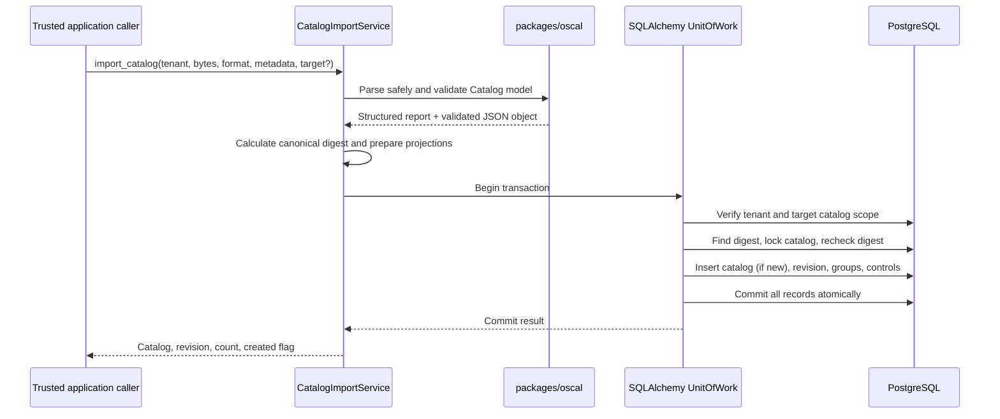

# OSCAL Catalog import

The internal `CatalogImportService` imports raw JSON or YAML bytes into the existing
tenant-scoped catalog repository. Before the browser integration there was no HTTP
import endpoint: the CLI and trusted application callers were the only adapters.
The service does not discover logical catalog identity automatically: callers must
explicitly select a target to create a revision or detect an existing document.
Without a target, even an identical document creates a separate logical catalog.

The HTTP adapter accepts the unchanged UTF-8 JSON document as `application/json`
at `POST /api/v1/tenants/{tenant_id}/catalogs/import`, or at
`POST /api/v1/tenants/{tenant_id}/catalogs/{catalog_id}/import` for an explicit
target. Both require `catalog:import`. The response identifies the catalog and
revision and reports whether a revision was created; identical content in the
selected catalog returns the existing revision. The configured
`CATALOG_IMPORT_MAX_INPUT_BYTES` limit applies. Existing profiles and implementation
references remain pinned to their original revisions.

## Architecture and processing



Parsing and validation happen before opening a database transaction. Invalid input
raises `CatalogImportValidationError` with a reusable `CatalogValidationResult`;
invalid content is never persisted. A valid import verifies the tenant and
tenant-scoped target catalog, creates a logical catalog if no target was given,
then writes the catalog, draft revision, and derived group/control projections in
one unit of work. Database errors roll back the whole transaction.

The importer reuses `canonical_json_sha256` from the OSCAL package. JSON and YAML
documents with the same parsed values therefore have the same digest. Digest
lookups are scoped to one logical catalog. A partial unique database index on imported revisions and a lock
on the logical catalog serialize same-catalog imports; a second digest lookup after
the lock makes identical concurrent imports return the existing revision. A
different digest creates the next draft revision. Published revisions are never
updated; an identical published revision is returned as-is.

Group and control indexes are rebuilt from the stored OSCAL object with the existing
projection helper. Hierarchy and source order are retained, and identifiers can
repeat in separate catalogs. Indexes are tied to the exact tenant and revision.
The original JSON/YAML semantic content is preserved in JSONB; YAML comments and
formatting are not retained.

The structured validation result includes `valid`, document type, declared OSCAL
version, validator name/version, validation schema version, errors, and warnings.
Errors have a stable code, safe human-readable message, optional JSON Pointer, and
optional diagnostic code. Parser errors do not include imported content. The
default input limit is 10 MiB and the default maximum nesting depth is 64; both can
be overridden on the internal service. YAML uses `SafeLoader`, rejects duplicate
mapping keys and aliases, permits one document only, and does not resolve dates to
Python objects. JSON duplicate object keys and non-finite numbers are rejected.
Both formats require UTF-8. No URLs or references are fetched.

## Compatibility

| Area | Supported behavior |
|---|---|
| compliance-trestle | `5.2.0` (dependency range `>=5.2,<5.3`) |
| Python | Trestle declares `>=3.11`; this repository targets Python 3.12–3.13 |
| OSCAL versions accepted by Catalog import | `1.1.3`, `1.2.0`, `1.2.1`, `1.2.2`, `1.2.3` |
| OSCAL versions accepted by Profile generation/export | `1.1.3`, `1.2.0`, `1.2.1`, `1.2.2`, `1.2.3` |
| Default for newly generated Profiles | `1.2.3` |
| OSCAL documents | Catalog JSON model only |
| Input formats | JSON and YAML; optional safe first-character auto-detection |
| Version-specific validation | compliance-trestle 5.2.0 models through OSCAL 1.2.1; bundled official NIST JSON Schema Draft 7 for 1.2.2 and 1.2.3 |
| Additional Catalog checks | Existing group/control projection and duplicate control-ID rejection |

### Official schema provenance

The schemas are bundled locally; application validation makes no runtime network
requests. Each checked-in schema is sourced from the matching OSCAL release's
`oscal_catalog_schema.json` or `oscal_profile_schema.json` asset. The table gives
SHA-256 for the exact checked-in bytes.

| OSCAL release | Catalog schema SHA-256 | Profile schema SHA-256 |
|---|---|---|
| [1.2.2](https://github.com/usnistgov/OSCAL/releases/tag/v1.2.2) | `fdc559f5dff6848b1ebbe1898a69cc08263479f7c796e2f056412059e7489d0c` | `04329bd68032f48825f712f79576b3fd00e129e59d3597beb56ed72c17277f66` |
| [1.2.3](https://github.com/usnistgov/OSCAL/releases/tag/v1.2.3) | `ab95836e9e8dfebf6fde80007f6cc76fa3192f595d427c751a3f3923c3f474fc2` | `7c5ff5a92683b6a80ce6a3474dea04e0ea8680a4ecb60702ffa08ebfc677e6cb` |

The 1.2.2 and 1.2.3 schemas are version-specific, not aliases. Comparing the NIST
release assets shows that 1.2.2 corrects JSON integer datatypes (the Catalog schema
changes only its version identifier from 1.2.1).
For 1.2.3, the Catalog schema changes only its version identifier, while the Profile
schema updates the description of `modify.alters.removes` matching by item name.
These differences are why the declared version selects its own schema for these
newer versions rather than falling back to the latest one.

### Parsing and dependency boundary

The importer validates OSCAL 1.1.3, 1.2.0, and 1.2.1 Catalogs with compliance-trestle
5.2.0's generated 1.2.1 model and its backward-compatibility handling. OSCAL 1.2.2
and 1.2.3 Catalogs use their corresponding official NIST schemas. Profile validation
uses the same version split. The BSI 1.1.3 Catalog and generated Profiles through
1.2.1 are covered by application tests. Trestle models are used only for validation:
the parsed input dictionary is returned and persisted without rewriting
`metadata.oscal-version`, identifiers, or fields. Catalog `x-` extension keys are
excluded from the validation view; their original values remain in the imported
document and extension-specific constraints are not checked.

The 1.2.2 and 1.2.3 schema paths are temporary compatibility bridges. Replace them
with compliance-trestle validation when an approved Trestle release supports those
versions; keep the version-specific compatibility tests and document-preservation
behavior.

The BSI Grundschutz++ fixture declares OSCAL 1.1.3 and passes Trestle model
validation and existing projections. The official NIST SP 800-53 Rev. 5.2.0 Catalog fixture is from
the independent [OSCAL Content release `v1.5.0`](https://github.com/usnistgov/oscal-content/releases/tag/v1.5.0);
its declared OSCAL version is 1.2.2.
The checked-in fixture
[`NIST_SP-800-53_rev5_catalog-min.json`](../apps/api/tests/fixtures/NIST_SP-800-53_rev5_catalog-min.json)
has SHA-256 `d820835aa54aeb2265bdacdf8e678af7530443a59556563df898addf012024cb`.
The smaller local Catalog fixture used for other version cases is self-authored test
data, not NIST content.

Trestle model validation and Catalog/Profile JSON Schema validation are distinct
from comprehensive OSCAL semantic validation. Catalog import also projects groups
and controls and rejects duplicate control identifiers. Validation does not
implement every NIST Metaschema semantic constraint. Profile validation does not
resolve its imports or guarantee that a resolver can compose the referenced
Catalogs. No Trestle CLI or remote schema download is used.

## Provenance and security boundary

Existing catalog columns store source URI, source organization, and license
identifier. Revision columns store the OSCAL document UUID/version, source
document version, canonical checksum, creation/import timestamp, and input format.
The full source metadata including title, publisher and `last-modified` remains in
the authoritative OSCAL content. Imported OSCAL metadata is not rewritten.

`tenant_id` is an explicit application-service argument and every catalog lookup,
duplicate check, and revision write is tenant-scoped. The caller must provide a
tenant identity established by a trusted boundary; the HTTP adapter authenticates
and authorizes the caller before invoking it. Catalog IDs from another tenant are indistinguishable from
missing IDs. Tenant IDs in imported documents are never used. Input parsers do not
instantiate YAML objects, follow paths, or access the network; errors and
diagnostics exclude full document content.

## Local development

Run from `apps/api` after installing the locked dependencies and starting the local
PostgreSQL database. The example uses an explicitly selected tenant ID and is for a
trusted developer/admin process only; it is not an authenticated user interface.

```python
import os
from pathlib import Path
from uuid import UUID

from app.application.catalog_import import CatalogImportService
from app.persistence.database import create_unit_of_work_factory

service = CatalogImportService(create_unit_of_work_factory())
tenant_id = UUID(os.environ["TENANT_ID"])
source = Path("catalog.json")
validation = service.validate_catalog(source.read_bytes(), "json")
if not validation.result.valid:
    for error in validation.result.errors:
        print(error.code, error.path, error.message)
    raise SystemExit(1)

result = service.import_catalog(
    tenant_id,
    source.read_bytes(),
    "json",
    target_catalog_id=None,
)
print(result.catalog.id, result.revision.id, result.control_count)
```

Set `target_catalog_id` to import a new revision into an existing tenant-owned
logical catalog. Without it, each call creates a new logical catalog.

## Local sample data

The CLI defaults to a 10 MiB input limit, which accommodates the supplied 5,401,489-byte
BSI catalog. For larger catalogs, set
`CATALOG_IMPORT_MAX_INPUT_BYTES` (bytes, at most 100 MiB) in the environment or
root `.env`. For example, `CATALOG_IMPORT_MAX_INPUT_BYTES=10485760` allows
10 MiB inputs without disabling OSCAL validation.

Two self-authored OSCAL 1.2.1 catalogs live in `examples/catalogs/`. Import them with `python -m app.cli create-tenant` and `import-catalog` (run from `apps/api`); see [Catalog Explorer](architecture/catalog-explorer.md#local-setup). The CLI uses the same import service and validation as every other caller.
