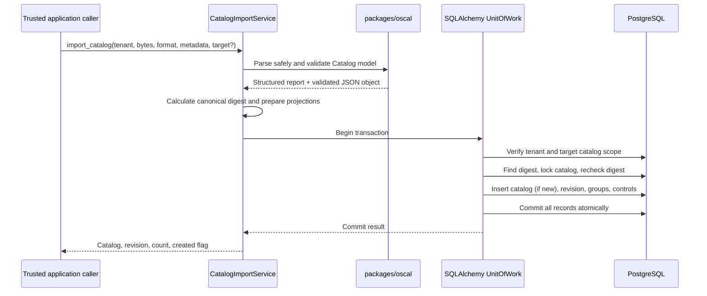

# OSCAL Catalog import

The internal `CatalogImportService` imports raw JSON or YAML bytes into the existing
tenant-scoped catalog repository. It is an application-service interface for future
REST, CLI, Git, and automation adapters; this change adds no HTTP endpoint or
authentication surface.

## Architecture and processing



Parsing and validation happen before opening a database transaction. Invalid input
raises `CatalogImportValidationError` with a reusable `CatalogValidationResult`;
invalid content is never persisted. A valid import verifies the tenant and
tenant-scoped target catalog, creates a logical catalog if no target was given,
then writes the catalog, draft revision, and derived group/control projections in
one unit of work. Database errors roll back the whole transaction.

The importer reuses `canonical_json_sha256` from the OSCAL package. JSON and YAML
documents with the same parsed values therefore have the same digest. Digest
lookups are scoped to one logical catalog. A partial unique database index on imported revisions and a lock
on the logical catalog serialize same-catalog imports; a second digest lookup after
the lock makes identical concurrent imports return the existing revision. A
different digest creates the next draft revision. Published revisions are never
updated; an identical published revision is returned as-is.

Group and control indexes are rebuilt from the stored OSCAL object with the existing
projection helper. Hierarchy and source order are retained, and identifiers can
repeat in separate catalogs. Indexes are tied to the exact tenant and revision.
The original JSON/YAML semantic content is preserved in JSONB; YAML comments and
formatting are not retained.

The structured validation result includes `valid`, document type, declared OSCAL
version, validator name/version, validation schema version, errors, and warnings.
Errors have a stable code, safe human-readable message, optional JSON Pointer, and
optional diagnostic code. Parser errors do not include imported content. The
default input limit is 10 MiB and the default maximum nesting depth is 64; both can
be overridden on the internal service. YAML uses `SafeLoader`, rejects duplicate
mapping keys and aliases, permits one document only, and does not resolve dates to
Python objects. JSON duplicate object keys and non-finite numbers are rejected.
Both formats require UTF-8. No URLs or references are fetched.

## Compatibility

| Area | Supported behavior |
|---|---|
| compliance-trestle | `5.2.0` (dependency range `>=5.2,<5.3`) |
| Python | Trestle declares `>=3.11`; this repository targets Python 3.12–3.13 |
| OSCAL versions accepted by this importer | `1.1.3` and `1.2.1` |
| OSCAL documents | Catalog JSON model only |
| Input formats | JSON and YAML; optional safe first-character auto-detection |
| `1.1.3` schema | [Official NIST `oscal_catalog_schema.json`](https://github.com/usnistgov/OSCAL/releases/tag/v1.1.3), validated with JSON Schema Draft 7 |
| OSCAL 1.2.1 validation | `trestle.oscal.catalog.Model.model_validate_json(..., strict=True, extra="allow")` |
| OSCAL 1.1.3 validation | Bundled NIST Catalog schema, validated with JSON Schema Draft 7 |

OSCAL 1.1.3 and 1.2.1 Catalog schemas differ: 1.2.1 adds constraints for Markdown
line and multiline fields, adds control-selection constructs, and relaxes some
required fields in group, parameter, and party objects. The supplied BSI Catalog
uses the common structures and validates against the official 1.1.3 schema. It also
passes the existing group/control projection checks. The importer validates 1.1.3
against its own bundled schema instead of applying 1.2.1 model assumptions; the
existing Trestle model path for 1.2.1 is unchanged. The declared version is preserved
and never rewritten. The 1.1.3 schema is bundled locally, so validation does not
fetch schemas or references over the network.

The official NIST 1.1.3 JSON Schema enforces its Catalog structure, fields, and
types. Trestle's generated Pydantic model enforces those constraints for 1.2.1.
Both versions use the existing group/control projector and reject duplicate control
identifiers. Validation results intentionally carry a warning: JSON Schema and model
validation are not exhaustive NIST Metaschema semantic validation. Full semantic
coverage, including every cross-reference and constraint in the specification,
remains a limitation. OSCAL `x-` extension fields and standard extension properties
are preserved, but extension-specific constraints are not independently validated.
No Trestle CLI or remote schema download is used.

## Provenance and security boundary

Existing catalog columns store source URI, source organization, and license
identifier. Revision columns store the OSCAL document UUID/version, source
document version, canonical checksum, creation/import timestamp, and input format.
The full source metadata including title, publisher and `last-modified` remains in
the authoritative OSCAL content. Imported OSCAL metadata is not rewritten.

`tenant_id` is an explicit application-service argument and every catalog lookup,
duplicate check, and revision write is tenant-scoped. The caller must provide a
tenant identity established by a trusted boundary; authentication and authorization
are not implemented. Catalog IDs from another tenant are indistinguishable from
missing IDs. Tenant IDs in imported documents are never used. Input parsers do not
instantiate YAML objects, follow paths, or access the network; errors and
diagnostics exclude full document content.

## Local development

Run from `apps/api` after installing the locked dependencies and starting the local
PostgreSQL database. The example uses an explicitly selected tenant ID and is for a
trusted developer/admin process only; it is not an authenticated user interface.

```python
import os
from pathlib import Path
from uuid import UUID

from app.application.catalog_import import CatalogImportService
from app.persistence.database import create_unit_of_work_factory

service = CatalogImportService(create_unit_of_work_factory())
tenant_id = UUID(os.environ["TENANT_ID"])
source = Path("catalog.json")
validation = service.validate_catalog(source.read_bytes(), "json")
if not validation.result.valid:
    for error in validation.result.errors:
        print(error.code, error.path, error.message)
    raise SystemExit(1)

result = service.import_catalog(
    tenant_id,
    source.read_bytes(),
    "json",
    target_catalog_id=None,
)
print(result.catalog.id, result.revision.id, result.control_count)
```

Set `target_catalog_id` to import a new revision into an existing tenant-owned
logical catalog. Without it, each call creates a new logical catalog.

## Local sample data

The CLI defaults to a 10 MiB input limit, which accommodates the supplied 5,401,489-byte
BSI catalog. For larger catalogs, set
`CATALOG_IMPORT_MAX_INPUT_BYTES` (bytes, at most 100 MiB) in the environment or
root `.env`. For example, `CATALOG_IMPORT_MAX_INPUT_BYTES=10485760` allows
10 MiB inputs without disabling OSCAL validation.

Two self-authored OSCAL 1.2.1 catalogs live in `examples/catalogs/`. Import them with `python -m app.cli create-tenant` and `import-catalog` (run from `apps/api`); see [Catalog Explorer](architecture/catalog-explorer.md#local-setup). The CLI uses the same import service and validation as every other caller.
